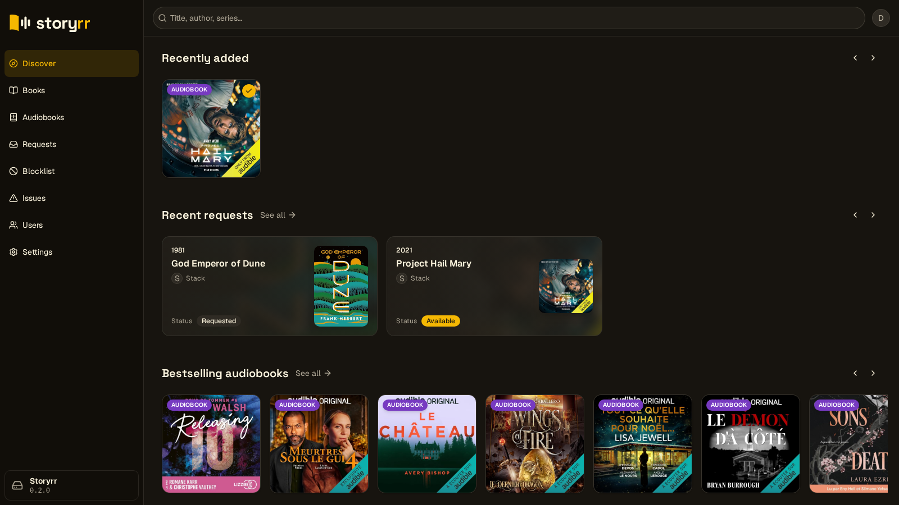

  <picture>
    <source media="(prefers-color-scheme: dark)" srcset="docs/assets/logo-dark.svg">
    
  </picture>

  
  

  
  

**Storyrr** is a free and open source request manager for **audiobooks and eBooks (including manga and comics)**, in the spirit of [Seerr](https://github.com/seerr-team/seerr), for the book side of a homelab. It hands requests to **[Chaptarr](https://github.com/Chaptarr/chaptarr)** and integrates with the media server of your choice: [Audiobookshelf](https://www.audiobookshelf.org/), [Kavita](https://www.kavitareader.com/), [Komga](https://komga.org/) and [Jellyfin](https://jellyfin.org/).

## Current Features

- Search and discovery of audiobooks (Audible's catalog) and eBooks, manga and comics ([Hardcover](https://hardcover.app/)), with series, authors, genres and readers' ratings.
- Simple request management: approve or deny in one place, with auto-approval, per-user limits and the target Chaptarr folder chosen per request.
- Library sync with Chaptarr, Audiobookshelf, Kavita, Komga and Jellyfin, to keep track of the titles which are already available.
- A button to read or listen to an available title right in your media server.
- Sign in with Audiobookshelf, Kavita, Komga or Jellyfin, with user import. Accounts are invite-only.
- Granular permission system.
- Issues, to report a wrong edition or language, and a blocklist.
- Notifications by email, Discord, Slack, Telegram, ntfy, Gotify, Pushover, Pushbullet, webhook and Web Push.
- Mobile-friendly design, installable as an app on phones.
- English, French, German and Spanish.

> **Status: pre-release.** The v1 features work; expect changes until 1.0.

## Getting Started

Check out our documentation for instructions on how to install and run Storyrr:

https://storyrr.github.io/getting-started/introduction/

## Preview

## Support

- Check out the [Storyrr documentation](https://storyrr.github.io) before asking for help. Your question might already be answered there!
- You can ask questions in [GitHub Discussions](https://github.com/Storyrr/storyrr/discussions).
- Bug reports and feature requests can be submitted via [GitHub Issues](https://github.com/Storyrr/storyrr/issues).

## Contributing

You can help improve Storyrr too! Check out the [Contribution Guide](CONTRIBUTING.md) to get started. The stack, architecture and conventions are described in [AGENTS.md](AGENTS.md), the product in the [v1 spec](docs/SPEC.md).

## License

[MIT](LICENSE).
